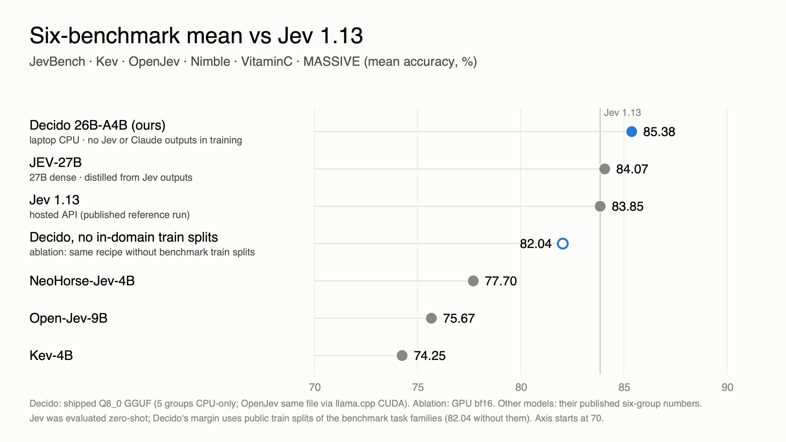

# Decido

**Calibrated yes/no, pick-one and rating decisions about a document — on a laptop CPU.**

Decido takes a `state` (text, JSON or a list) and typed questions, and returns a probability for every answer in the same
wire format as TypeSafe's Jev "System One" API. The model is a LoRA fine-tune of Gemma 4 26B-A4B (~4B active parameters),
shipped as an 8-bit GGUF for llama.cpp.



| | Decido 26B-A4B (CPU GGUF) | Jev 1.13 (published) |
|---|---:|---:|
| Six-group mean (JevBench, Kev, OpenJev, Nimble, VitaminC, MASSIVE) | **85.38** | 83.85 |
| …without the benchmarks' public train splits (ablation) | 82.04 | — |
| Brier better than Jev | 4 of 5 checks | — |
| Same input, same answer | always (per machine) | not always |
| Latency, 1k-token document + 5 questions | 4.1 s on an Apple M4 Pro CPU | ~0.3 s hosted API |

Trained on public data and an open Apache-2.0 teacher model — **no Jev outputs and no Claude outputs**. Jev's numbers are
its published reference run, not Jev run through this harness. Details and caveats: [model card](https://huggingface.co/decido-ai/decido-26b-a4b) ·
tech report (coming soon).

## Quick start (macOS / Linux, ~30 GB RAM)
```bash
git clone https://github.com/decido-ai/decido decido && cd decido
./install.sh     # builds llama.cpp + vserve, downloads the model, runs example.py
```
```python
from decido.predictor_llamacpp import DecidoLlamaCpp
m = DecidoLlamaCpp(gguf="decido-26b-a4b-q8_0.gguf", bundle="bundle", threads=10, jev_wire=True)
print(m({"state": "Customer: I was charged twice for order 4821.",
         "questions": {"refund": {"type": "noul", "instructions": "Is the customer asking for a refund?"},
                       "team": {"type": "choice", "instructions": "Which team handles this?",
                                "criteria": {"billing": "Charges and refunds", "shipping": "Delivery"}}}}))
```
Question types: `noul` (yes/no; returns P(yes)), `choice` (2–255 options; probabilities, argmax, confidence),
`score` (2–10 ordered levels; probabilities, expected level, confidence). Requests up to ~16k tokens; longer states are
rejected with `max_tokens_exceeded`. `perm=4` averages over four option orders (less order-sensitive, ~4× choice cost).

## Jev-compatible API server
Run Decido behind the same HTTP API as TypeSafe's Jev (`POST /v1/systemone`), so existing Jev apps can switch with one
setting. Standard library only; binds to 127.0.0.1 by default.
```bash
python -m decido.server --gguf decido-26b-a4b-q8_0.gguf --bundle bundle --port 8080
```
Use it with the official TypeSafe SDK, unchanged:
```bash
TYPESAFE_BASE_URL=http://127.0.0.1:8080 TYPESAFE_API_KEY=local python your_app.py
```
or with plain HTTP:
```bash
curl -s http://127.0.0.1:8080/v1/systemone -H 'Content-Type: application/json' -d '{
  "state": "I was charged twice for order 4821, please refund one charge.",
  "questions": {"refund": {"type": "noul", "instructions": "Is the customer asking for money back?"}}}'
```
Supports `noul`, `choice` (2–255 options) and `score` (2–10 levels); gzip and zstd request bodies; Jev's status codes
(400 incl. `max_tokens_exceeded`, 413, 415, 422). Set `DECIDO_API_KEY` to require `Authorization: Bearer <key>` (do this
before using `--host 0.0.0.0`). `--workers 2` serves two requests in parallel (~4 GB extra RAM). Tested with the official
`typesafe-sdk` 0.7.5 quickstart.

## What's in this repo
| path | what |
|---|---|
| `decido/` | runtime (`template.py`, `readout.py`, `derive.py`, `predictor_llamacpp.py`), Jev-compatible HTTP server (`server.py`), GPU predictor (`predictor_hf.py`), trainer (`train.py`), labelling, merge, bundle, temperature fit, dev rule, agreement checks |
| `decido/data/` | training-data builders: source download (train splits only), pool builder, task-held-out splits, teacher target mixing, decision tables, compound questions, teacher-written scenarios |
| `tools/vserve/` | `vserve.cpp`: libllama server — reads the state once, answers each question from the cache, bit-deterministic per machine |
| `eval/parity/` | six-group parity harness: suite builders, scoring rules matching each benchmark, Brier/ECE, option-flip and determinism tests, CPU-only enforcement, latency fixture, leakage gate |
| `results/` | summaries and reports of every headline run (no evaluation items) |
| `docs/REPRODUCE.md` | how to rebuild the evaluation suites, the training data and the model |

## Reproducing the evaluation
The frozen evaluation files are **not** redistributed (Nimble has no licence, GPQA asks that items not be republished, ANLI
is non-commercial). `docs/REPRODUCE.md` lists the exact source commits; `python -m eval.parity.build` rebuilds the suites,
and `eval/parity/data/MANIFEST.json` / `items.sha256` let you confirm byte-identical files. Then:
```bash
python -m eval.parity.run --predictor decido.predictor_llamacpp:DecidoLlamaCpp \
  --predictor-kw gguf=decido-26b-a4b-q8_0.gguf --predictor-kw bundle=bundle --predictor-kw threads=10 --name my-run
```
The full CPU suite is ~57M prompt tokens (days on a laptop); `--limit-per-task N` gives a quick deterministic subsample.

## Licence
Apache-2.0 (see `LICENSE`, `NOTICE`).
